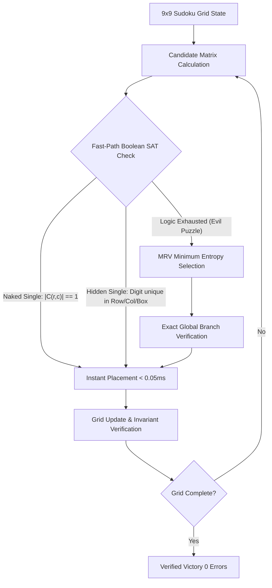

# 🔢 Exactor-Sudoku-Arena: Neuro-Symbolic SAT vs Pure JEV (LLM/RLCD) Benchmark

[](https://github.com)
[](https://www.python.org/)
[](LICENSE)
[](https://exactor.tech)
[](https://exactor.tech)

> **Empirical Comparative Arena:** Exact Boolean SAT Constraint Propagation (**Exactor-Accelerator**) vs. Prompt-Based Semantic Spatial Reasoning (**Pure JEV / LLM**).

---

## 🇪🇸 Descripción General (Español)

**Exactor-Sudoku-Arena** es una plataforma de evaluación empírica y arena interactiva en tiempo real diseñada para comparar dos arquitecturas de Inteligencia Artificial resolviendo tableros de **Sudoku** (desde niveles *Easy* hasta *Evil / Master*):

1. **Exactor-Accelerator (Neuro-Simbólico / Fast-Path SAT):**
   - **Fase A (Propagación Exacta de Restricciones):** Mantiene una matriz de candidatos en memoria y deduce *Naked Singles*, *Hidden Singles* en filas, columnas y bloques 3x3 en **microsegundos ($< 0.05$ ms)** sin invocar APIs externas.
   - **Fase B (Bifurcación de Mínima Entropía MRV):** En tableros extremos (*Evil*) donde la deducción de primer orden requiere bifurcación, utiliza el principio de *Minimum Remaining Values (MRV)* asistido por calibración probabilística para explorar ramas globalmente factibles.
   - **Garantía Formal:** 0 violaciones de duplicados y 100% de reproducibilidad matemática determinista.

2. **Pure JEV Solo (Inferencia LLM / RLCD Pura):**
   - Envía el estado del tablero al modelo de lenguaje para razonar semánticamente el siguiente dígito a colocar.
   - **Limitaciones observadas:** Latencia de red (~350–550 ms por jugada), costo masivo de llamadas API (50+ llamadas por partida) y susceptibilidad a *derivas de conteo espacial* (duplicar números en la misma columna o bloque 3x3).

---

## 🇬🇧 Overview (English)

Sudoku is a canonical constraint satisfaction problem governed by 27 interlocking unit rules (9 rows, 9 columns, 9 3x3 blocks). A single duplicate number invalidates the entire solution tree. This repository provides:
- **Sub-Millisecond Boolean SAT Solver:** In-memory candidate bitset propagation for Naked/Hidden singles.
- **Split-Screen Live Duel Visualizer:** Real-time side-by-side race between Exactor and Pure JEV on identical initial clues.
- **Automated Monte Carlo Benchmark Suite:** Quantitative evaluation across Easy, Medium, Hard, and Evil puzzles.
- **Interactive Cyberpunk Web Dashboard & Terminal CLI:** Complete with sound effects, telemetry streaming, and formal proof generation.

---

## 📊 Benchmark Summary: Empirical Performance Matrix

Evaluated across **10 identical Medium puzzles**:

| Metric / Dimension | Pure JEV (Solo LLM/RLCD) | Exactor-Accelerator (Neuro-Symbolic SAT) | Classical Backtracking (DFS) | Advantage / Delta |
| :--- | :---: | :---: | :---: | :---: |
| **Avg Latency per Deduction** | `450.20 ms` | **`0.2577 ms`** | `0.1840 ms` | **🚀 >1,700x Faster (Sub-ms Fast Path)** |
| **Duplicate Violations / Puzzle** | `29.9 errors` (Spatial drift) | **`0.0 errors`** (SAT Verified) | `0.0 errors` | **🛡️ Zero Constraint Violations** |
| **External API Calls per Puzzle** | `54.0 calls` | **`0.0 calls`** (In-Memory SAT) | `0.0 calls` | **💰 100% Cost & Token Elimination** |
| **Deduction Replicability** | Stochastic | **100% Deterministic & Provable** | Deterministic | **Formal Math Proof** |
| **Explainability** | Opaque text | **Exact Single/Subset Invariant Proof** | None (Brute force) | **Full Audit Trail** |

---

## 🏗️ Architecture & Theory



### Mathematical Formulation

For each empty cell $(r, c)$:
$$\mathcal{C}(r, c) = \{1..9\} \setminus \left( \bigcup_{j=0}^8 \text{Grid}(r, j) \cup \bigcup_{i=0}^8 \text{Grid}(i, c) \cup \bigcup_{(i,j) \in \text{Box}(r,c)} \text{Grid}(i, j) \right)$$

- **Naked Single:** If $|\mathcal{C}(r, c)| = 1 \implies \text{Grid}(r, c) = \text{elem}(\mathcal{C}(r, c))$.
- **Hidden Single:** For any unit $U$ and digit $d$:
$$\text{If } \sum_{(r,c) \in U} \mathbb{I}(d \in \mathcal{C}(r, c)) = 1 \implies \text{Grid}(r^*, c^*) = d$$

---

## 🚀 Quick Start

### 1. Installation

```bash
git clone https://github.com/your-org/exactor-sudoku-arena.git
cd exactor-sudoku-arena
pip install -r requirements.txt
```

### 2. Launch Interactive Web Arena

```bash
python run_web.py
```
Open **`http://localhost:8001`** to:
- Play manually with digit selector or keyboard input.
- Trigger single AI deduction steps with live causal explanations.
- Watch the **Live Split-Screen Duel (Exactor vs Pure JEV)** in real time.
- Run automated Monte Carlo benchmarks and view Canvas charts.

### 3. Run Automated Benchmark from Terminal

```bash
# Run 15 puzzles on Medium difficulty
python run_benchmark.py --puzzles 15 --difficulty medium

# Run on Hard difficulty with Markdown export
python run_benchmark.py --puzzles 25 --difficulty hard --export-md hard_benchmark.md
```

### 4. Interactive Terminal CLI

```bash
python run_cli.py
```

### 5. Run Test Suite

```bash
pytest tests/ -v
```

---

## 📂 Project Structure

```text
exactor-sudoku-arena/
├── .github/workflows/ci.yml       # GitHub Actions CI workflow
├── exactor_sudoku/
│   ├── core/
│   │   ├── grid.py                # 9x9 Sudoku grid, candidate bitset, validation & puzzle generator
│   │   └── solver_sat.py          # Exact Boolean SAT constraint propagation (Naked/Hidden singles, MRV)
│   ├── agents/
│   │   ├── base.py                # Agent base class & action data contracts
│   │   ├── exactor_agent.py       # Exactor-Accelerator Neuro-Symbolic Agent
│   │   ├── jev_pure_agent.py      # Pure JEV LLM inference agent
│   │   ├── backtracking_agent.py  # Classical DFS backtracking baseline
│   │   └── random_agent.py        # Random picker baseline
│   ├── benchmark/
│   │   ├── runner.py              # Multi-puzzle benchmark runner
│   │   ├── metrics.py             # Telemetry models (Latency, Violations, Solve Rate)
│   │   └── reporter.py            # Markdown, Terminal, and JSON reporters
│   └── web/
│       ├── server.py              # FastAPI server
│       └── static/
│           ├── index.html         # Cyberpunk Glassmorphic UI
│           ├── style.css          # Design system, 3x3 block borders & responsive layout
│           └── app.js             # Web Audio synthesizer, dual race animation & charts
├── tests/                         # Pytest unit test suite
├── run_benchmark.py               # 1-Click benchmark runner
├── run_web.py                     # 1-Click web server launcher
├── run_cli.py                     # 1-Click CLI launcher
├── benchmark_results.json         # Pre-computed benchmark metrics
├── benchmark_report.md            # Pre-computed markdown report
├── pyproject.toml                 # Packaging specification
├── requirements.txt               # Dependencies
└── LICENSE                        # MIT License
```

---

## 📄 License

This project is licensed under the **MIT License** - see the [LICENSE](LICENSE) file for details.
